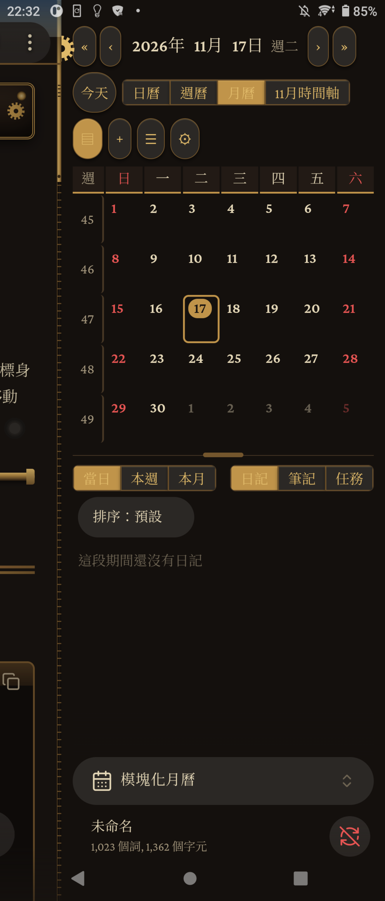
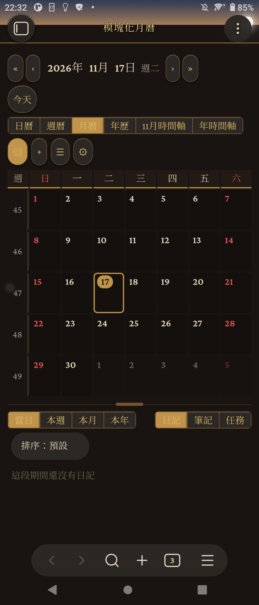
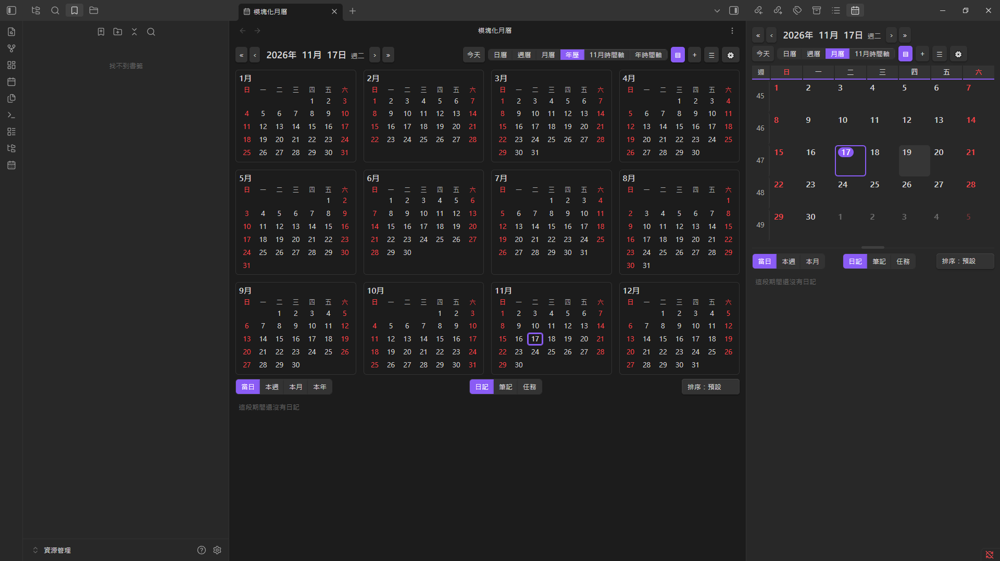
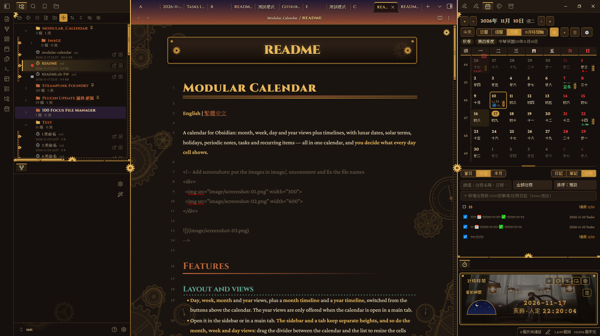

# Modular Calendar Beta

**English** | [繁體中文](README.zh-TW.md)

A calendar for Obsidian: month, week, day and year views plus timelines, with lunar dates, solar terms, holidays, periodic notes, tasks and recurring items — all in one calendar, and **you decide what every day cell shows**.

  
  

## Features

### Layout and views
- **Day**, **week**, **month** and **year** views, plus a **month timeline** and a **year timeline**, switched from the buttons above the calendar. The year views are only offered when the calendar is open in a main tab.
- Open it in the sidebar or in a main tab. **The sidebar and a tab keep separate heights, and so do the month, week and day views**: drag the divider between the calendar and the list to resize the cells (double-click resets); there is no height limit in a tab. When a cell's content is taller than the cell, the cell scrolls.
- The week view has two modes: **week number** (the week containing the selected day, with its number) and **today** (today on the left, then the next six days). In a narrow pane it turns into one row per day.
- The header shows "YYYY年 M月 D日", the season and quarter, and the lunar date; `«` `»` jump a year, `‹` `›` a month / week / day, click the year or month to jump, "Today" goes back to today. The toolbar wraps when the sidebar is narrow.
- Start date: choose the earliest day the calendar can show (optionally plus an elapsed time).

### Calendar data
- Lunar date, lunar festivals and solar terms; seasons and quarters with defaults or your own.
- **Another date line**: a national era (Reiwa, Minguo, Buddhist era), the national lunar date, or a custom one (start date + elapsed time, with a name).
- Japan mode: Japanese weekdays, era names, rokuyō and the old calendar.

### Holidays and badges
- Download public holidays for **Taiwan, China, Japan, the US and many other countries** (see *Disclosures*), or choose "custom" and import your own JSON.
- **Rest / work / custom badges**: color, opacity, cell background, position (inside the cell or on its border) and alignment are configurable; the priority of badges and backgrounds can be reordered by dragging. The month and year views use the same colors.
- Custom badges use date rules (each rule needs a year or a count). Right-click → **Add custom badge** adds an existing or new badge to a day, or choose "None" to cancel that day's custom badges. A custom badge whose label equals the rest / work label is treated as part of the downloaded holidays.

### Periodic notes
- Daily, weekly, monthly, quarterly and yearly notes plus an "item/task diary"; folders, year/month sub-folders and file-name formats are configurable.
- Templates support `{{date}}`, `{{date:format}}` and `{{title}}` (daily notes also get lunar, solar term and holiday variables); Templater syntax is processed if Templater is installed. A template can be a file, several files or a folder — with several, a picker appears before creating.
- Right-click a day, the week-number column or the header to create day / week / month / quarter / year notes; double-click a day to open or create the daily note; open in the current tab or a new tab.
- A day can have extra daily notes, and "extra sources" assign notes from other folders to a day by a YAML date property.

### Day cells
- Built-in modules: solar date, lunar date, lunar festival, solar term, holiday name, rest/work/custom badges, holiday background, note dot, task-list dot, daily content. Each module can be switched on or off and placed in a cell slot.
- **Info rows**: items under the date get a row each by default; drag an item behind another to share a row, or drag a whole row to reorder.
- **☰ Calendar content** (next to the settings gear): tick what every day cell lists — custom items/tasks, tasks, note names, completed tasks. The maximum per day is configurable (automatic by default); beyond it the cell shows "N more…", click to expand and click again to collapse.
- Dots: shape, color, maximum count, automatic switch to a number by cell size; the note dot and the task dot can each read their own files or folders. Pending tasks show "⚠ count" (symbol and color are configurable).
- Hover the date number to list everything about that day (lunar date, solar term, festival, holiday, badges, custom items/tasks, notes and pending tasks).
- Week-number column, week statistics, grid lines, fonts and all colors (theme colors or your own) are adjustable.
- **Action modules**: choose what a click, a double-click and a right-click do.

### List under the calendar
- Scope: day, week, month, year; content: notes, extra notes, tasks.
- Notes can be sorted by name or by the date in the file name; tasks can be filtered (name, date, file name, source) and sorted (name, time, time left, name-time).
- The number of visible rows is fixed or automatic (fills the space below the calendar); the quick-add input lets you pick the heading; the month / year timelines list tasks and sort them by name.

### Tasks
- Tasks are written into the day's item/task diary or the daily note, under a heading you pick (several headings can be configured); the diary can use task templates.
- Time status next to a task follows the **Tasks plugin's date logic**: due (📅), start (🛫), scheduled (⏳) — e.g. "due today", "starts in 12 days", "overdue by 3 days" — with configurable text and colors.
- Optional **Tasks plugin** integration: right-click → "New task (Tasks style)" opens its "Create or edit task" panel, after letting you pick the location, template and heading; right-click a task in the list or timeline to edit it with the same panel.

### Custom items and tasks
- Right-click a day → **Create custom item/task** opens one form: type (task you can tick / item that is only shown), storage (long-term / same day), repeat (none / daily / weekly / monthly / yearly / custom), strategy (must-do / check-in), every N days / weeks / months / years, weekdays, month days, counting from month end, start date, times, per-time count, per-period count and end (forever / end date / after N cycles). Dates and times can be picked with quick buttons; a live summary is shown below.
- **Long-term** items are stored where you choose (root folder, year/month sub-folders, file-name format, or a custom path in the form); **same-day** ones are written into that day's item/task diary and shown in that day's cell.
- Missed must-do tasks stay in the task list (marked "make-up") until done; missed check-in tasks are skipped.
- Ticking a task in the calendar **writes the completion back into the note**; changing it in the note updates the calendar.
- The form can be saved as a **template**, applied later, and exported to / imported from a file.
- Right-click → **View custom items/tasks** (a resizable window) or **Open view in a new tab**: filter, sort, edit, copy, delete and reorder.

### Settings
- Settings are split into categories (a row of buttons at the top) and searchable; settings that must be confirmed (custom badges, the other date line) have a "Save & apply" button with a status; presets are built in (all modules off = a plain standard calendar).

## Installation

**Manually:** download `main.js`, `manifest.json` and `styles.css` from the latest [release](../../releases) into `<vault>/.obsidian/plugins/modular-calendar/`, then enable the plugin in the settings.

**BRAT:** add this repository's URL in the BRAT plugin.

**Community plugin list:** once accepted, search for Modular Calendar under Settings → Community plugins → Browse.

Open it from the ribbon icon or the command palette ("Open calendar", "Open calendar in a new tab", "Open custom items/tasks in a new tab").

## Disclosures

- **No telemetry, no payment.** The plugin only uses the network when you choose a holiday source in the settings: it downloads the holiday data for the years you view and caches it in the plugin's data file; choose "custom" to stay offline. Sources: Taiwan [ruyut/TaiwanCalendar](https://github.com/ruyut/TaiwanCalendar) and China [NateScarlet/holiday-cn](https://github.com/NateScarlet/holiday-cn) (both through `cdn.jsdelivr.net`), Japan, the US and other countries [Nager.Date](https://date.nager.at).
- It only reads and writes files inside your vault: periodic notes, long-term custom items/tasks in the "Tasks List" folder (configurable), the template file "自訂事項模板.md" (configurable location), and notes whose tasks you tick or edit. Same-day items/tasks get a hidden `%%cd%%` comment at the end of the line so the calendar can find them.
- It uses a few undocumented Obsidian internals: detecting and calling the Tasks plugin's API and commands, the Templater plugin, and opening this plugin's settings tab. These may change with Obsidian or those plugins.
- A long-term task's completion log is an indented task line under the item, so Tasks plugin queries may list those lines as ordinary tasks.
- Developed and tested on desktop (Windows). **Mobile has not been tested**; drag and drop in the settings may not work on touch screens.

## Issues and suggestions

If you hit a problem or have a suggestion, please [open an issue](https://github.com/yuri55448/Modular_Calendar/issues). Including your Obsidian version, plugin version, theme and steps to reproduce (or a screenshot) makes it much easier to handle. The full history is in [CHANGELOG.md](CHANGELOG.md).
