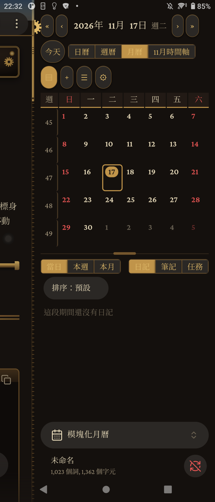
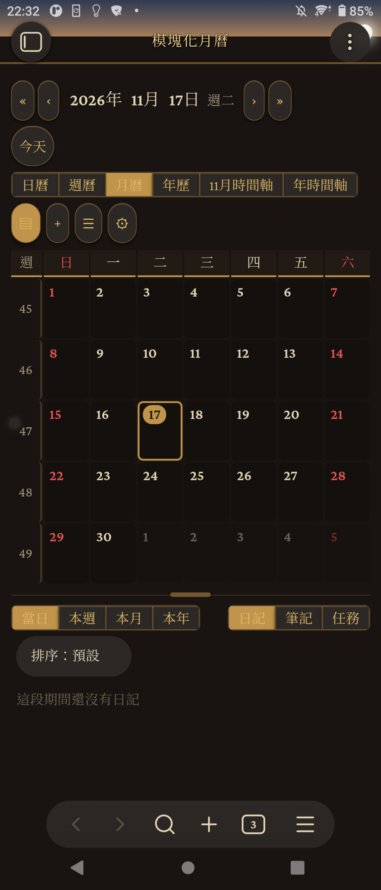
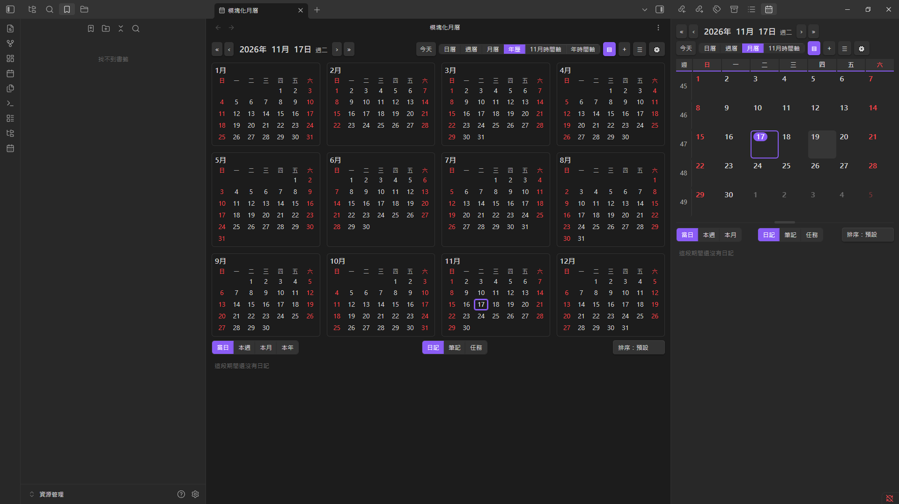
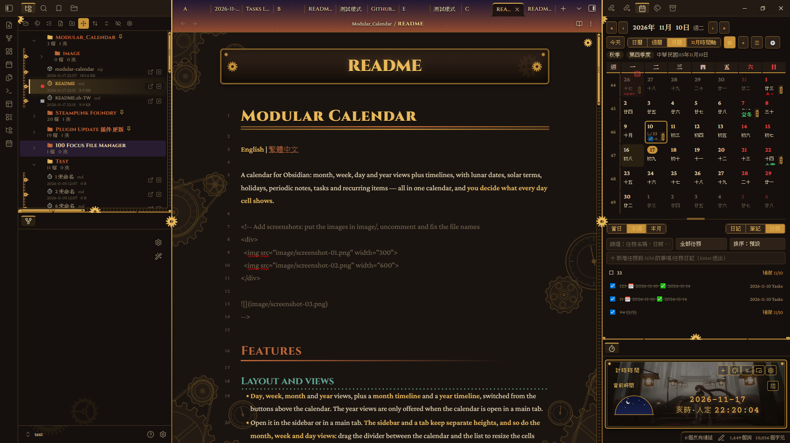

# 模塊化月曆 測試版

[English](README.md) | **繁體中文**

Obsidian 月曆插件：月曆、週曆、日曆、年歷與時間軸，農曆、節氣、節慶假日、週期筆記、任務與重複事項，全部整合在同一個月曆裡，**每天的格子要顯示什麼由你決定**。

  
  

## 功能

### 版面與檢視
- **日曆**（單日）、**週曆**、**月曆**、**年歷**，以及**月時間軸**、**年時間軸**，用月曆上方的按鈕切換。年歷與年時間軸只在新分頁開啟的月曆提供。
- 可放在側邊欄或主區域（新分頁）。**側邊欄與新分頁的高度各自獨立，月曆、週曆、日曆三種檢視也各自獨立**：拖曳月曆與下方清單之間的橫線調整格子高度（雙擊還原），新分頁沒有高度上限；內容超過格子高度時，格子裡自動變成滾動。
- 週曆有兩種顯示方式：**週數顯示**（預設，選取日所在的那一週，含週數）與**今日顯示**（最左邊是今天，往後共七天）。視窗窄（例如側邊欄）時，週曆會改成一天一列。
- 標題列顯示「YYYY年 M月 D日」、季節與季度、農曆年月日；`«` `»` 跳一年、`‹` `›` 跳一個月／週／日，點年或月可直接跳轉，「今天」回到今天。工具列在側邊欄縮小時會自動換行。
- 起始年月日：可設定月曆最早能翻到哪一天（可再加上「已經過多少年月日」）。

### 曆法資料
- 農曆日期、農曆節日、節氣；季節與季度可用預設或自訂。
- **顯示另一份年月日**：國家的年曆（日本令和、台灣中華民國、泰國佛曆）、國家的農曆年月日，或自訂（起始日期＋已經過的時間，可加名稱）。
- 日本模式：日文星期、年號、六曜、舊暦。

### 節慶假日與徽章
- 可下載**台灣、中國、日本、美國與其他國家**的假日（資料來源見下方「聲明」），也可選「純自訂」自行匯入 JSON。
- **休／班／自訂徽章**：顏色、透明度、整格底色、位置（格內或邊框）、對齊都能設定，徽章與底色的優先順序可拖曳排序；月曆與年歷顯示一致的顏色。
- 自訂徽章用日期規則設定（每條需指定年份或次數）；右鍵「**新增自訂徽章**」可替某一天加上已有或新建的徽章，也可選「無」取消那一天的自訂徽章。標籤跟「休」「班」同名的自訂徽章會視為休假／補班的一部分。

### 週期筆記
- 日記、週記、月記、季記、年記與「事項/任務日記」，資料夾、依年／月建立子資料夾、檔名格式都能設定。
- 模板支援 `{{date}}`、`{{date:格式}}`、`{{title}}`（日記另有農曆、節氣、假日變數），安裝 Templater 時會一併處理其語法；模板可指定單一檔案、多個檔案或資料夾，有多個時建立前跳出挑選器。
- 右鍵日期、週數欄或標題，可建立日／週／月／季／年記；雙擊日期開啟或建立日記；可選在目前分頁或新分頁開啟。
- 同一天可以有額外的日記；也可以用「額外來源」依 YAML 日期屬性，把其他資料夾裡的筆記歸到對應的日期。

### 每天的格子
- 內建模塊：公曆日期、農曆日期、農曆節日、農曆節氣、假日名稱、休／班／自訂徽章、假日底色、日記圓點、任務清單圓點、每日內容。每個模塊可以開關，並指定放在格子的哪個位置。
- **資訊列**：日期下方的內容預設每項各佔一列，把項目拖到另一個項目後面就會併成同一列，也能拖曳整列調整順序。
- **☰ 月曆內容**（設定齒輪旁的按鈕）：複選每天格子裡要顯示的內容——自訂事項／任務、任務、筆記名稱、已完成的任務；每天最多顯示幾筆可設定（預設依格子大小自動），超過會顯示「還有 N 筆記錄」，點一下展開、再點收起。
- 圓點：形狀、顏色、最多點數、依格子大小自動轉成數字，日記圓點與任務清單圓點可各自指定讀取的檔案或資料夾；有未完成的任務時顯示「⚠ 數量」（符號與顏色可改）。
- 滑鼠移到日期數字上，會列出當天全部的內容（農曆、節氣、節日、假日、徽章、自訂事項／任務、筆記與未完成任務）。
- 週數欄、週統計、格線、字體、各種顏色（可選主題顏色或自訂）都能調整。
- **操作模塊**：單擊、雙擊、右鍵各自指定要做什麼。

### 月曆下方清單
- 範圍：當日、本週、本月、本年；內容：日記、筆記、任務。
- 日記與筆記可依名稱或檔名日期排序；任務可篩選（名稱、日期、檔名、來源）並排序（名稱、時間、剩餘時間、名稱時間）。
- 一次顯示列數可固定，或自動吃滿月曆下方剩下的空間；快速新增任務時可選要加在哪個標題底下；月／年時間軸也能列出任務並依名稱排序。

### 任務
- 任務可寫進當日的「事項/任務日記」或一般日記，並加在指定的標題底下（可設定多個標題）；任務日記可套用任務模板。
- 任務旁依 **Tasks 插件的日期邏輯**顯示時間狀態：到期（📅）、開始（🛫）、預定（⏳），例如「今天到期」「12 天後開始」「已逾期 3 天」，文字與顏色可自訂。
- 與 **Tasks 插件**整合（選用）：右鍵「新增任務（Tasks 樣式）」叫出它的「Create or edit task」面板，新增前可先選存放位置、模板與標題；在清單或時間軸的任務上按右鍵可用同一個面板編輯。

### 自訂事項/任務
- 右鍵日期 →「**建立自訂事項/任務**」，用同一個表單設定：類型（任務可勾選／事項只顯示）、存放（長期／當日）、重複（不重複／每天／每週／每月／每年／自定義）、策略（必做類／打卡類）、每 N 個天／週／月／年、週幾、每月日期、月倒數、開始日期、時刻、點位次數、每 N 個單位的次數、結束方式（一直重複／截止日期／N 個週期後結束）。日期與時間都可以用點的快速選取，下方有即時摘要。
- **長期**的存在你指定的位置（根資料夾、依年／月建立子資料夾、檔名格式，也能在表單自訂路徑）；**當日**的直接寫進對應日期的事項/任務日記，並顯示在那一天的格子裡。
- 必做類任務錯過後會一直留在任務清單（標示「補做」）直到完成，打卡類錯過就略過。
- 在月曆裡勾選完成，會**寫回筆記**；在筆記裡直接修改完成狀態，月曆也會跟著變。
- 表單可儲存成**模板**、套用，也能導出到指定檔案或從檔案導入。
- 右鍵「**查看自訂事項/任務**」（視窗，可拖曳調整大小）或「**新分頁開啟 查看自訂事項/任務**」：篩選、排序、編輯、複製、刪除、上下移動。

### 設定頁
- 設定分成多個分類（頁面最上面一排按鈕），可搜尋；需要確認才套用的設定（例如自訂徽章、另一份年月日）有「保存應用」按鈕與儲存狀態；內建預設組合（全部關閉＝標準月曆）。

## 安裝

**手動：** 從最新的 [release](../../releases) 下載 `main.js`、`manifest.json`、`styles.css`，放進 `<庫>/.obsidian/plugins/modular-calendar/`，再到設定啟用插件。

**BRAT：** 在 BRAT 插件中加入本倉庫網址。

**社群插件清單：** 通過審核後，可在「設定 → 社群插件 → 瀏覽」搜尋 Modular Calendar。

從側邊的 ribbon 圖示或指令面板（「開啟月曆」「在新分頁開啟月曆」「在新分頁開啟『自訂事項/任務』」）開啟。

## 聲明

- **沒有遙測、不收費。** 只有在設定裡選了節慶假日來源時才會連網，下載你瀏覽的年份的假日資料，快取在插件的資料檔裡；選「純自訂」就完全不連網。資料來源：台灣 [ruyut/TaiwanCalendar](https://github.com/ruyut/TaiwanCalendar) 與中國 [NateScarlet/holiday-cn](https://github.com/NateScarlet/holiday-cn)（皆經 `cdn.jsdelivr.net`），日本、美國與其他國家 [Nager.Date](https://date.nager.at)。
- 只讀寫你的庫裡的檔案：週期筆記、「Tasks List」資料夾（可設定）裡的長期事項／任務、表單模板檔「自訂事項模板.md」（可設定位置），以及你勾選完成、編輯的筆記。「當日」建立的事項／任務會在行尾加上隱藏註解 `%%cd%%`，月曆靠它認出這些行。
- 用到少數 Obsidian 未公開的內部介面：偵測並呼叫 Tasks 插件的 API 與指令、Templater 插件、開啟本插件的設定頁，可能隨 Obsidian 或這些插件的版本變動。
- 長期任務的完成記錄是寫在事項下面的縮排任務行，Tasks 插件的查詢可能會把它們當成一般任務列出來。
- 目前在桌面版（Windows）開發與測試，**手機版尚未測試**；設定頁的拖曳排序在觸控螢幕上可能無法使用。

## 問題回報與建議

如果遇到問題或有任何建議，歡迎到 GitHub 專案中[提交 Issues](https://github.com/yuri55448/Modular_Calendar/issues)。回報時若能附上 Obsidian 版本、插件版本、使用的主題與重現步驟（或截圖），會更容易處理。完整的更新紀錄見 [CHANGELOG.md](CHANGELOG.md)。
